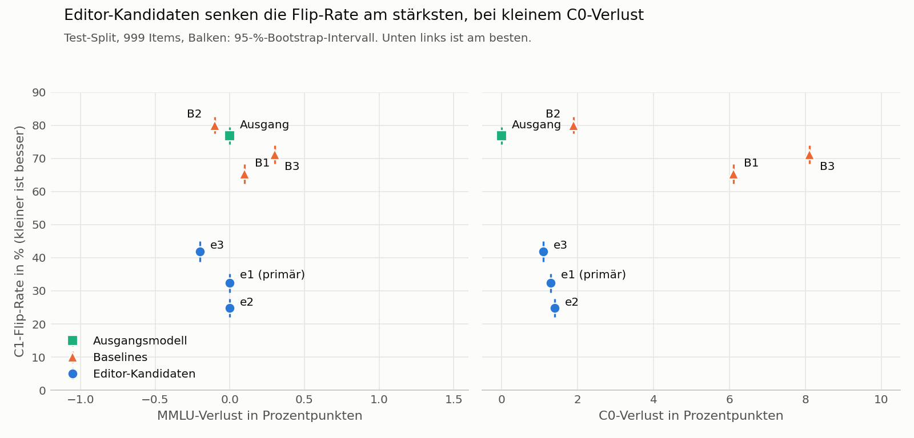

# Weight-Space Programming gegen Sykophanz

Ein kleines Open-Weight-Modell wird durch einen direkten, begründeten Gewichtsedit weniger sykophantisch: ohne Gradienten, ohne Training und mit einem gemessenen Vergleich gegen mechanische Baselines.

**Ergebnis:** Ein Edit an 0,23 % der Parameter von Qwen2.5-0.5B senkt die Rate, mit der das Modell einem falschen Hinweis des Nutzers folgt, auf einem blinden Test-Split von 76,8 % (95-%-KI 74,2 bis 79,4) auf 32,3 % (KI 29,4 bis 35,2). Alle vorab festgelegten Erfolgskriterien sind erfüllt.

**Wichtigster Vorbehalt:** Der Edit dämpft das Kopieren von Hinweisen allgemein. Bei Fragen, die das Modell nicht kennt, hilft auch ein richtiger Hinweis weniger (93,8 % → 65,2 %, 112 Items, Zusatztest außerhalb der Kriterien).

| Bedingung | C1-Flip % | C0-Acc % | C2-Acc % | MMLU % | Perplexität | Geänderte Parameter % |
| --- | --- | --- | --- | --- | --- | --- |
| Ausgangsmodell | 76,8 | 100,0 | 100,0 | 43,0 | 22,87 | 0 |
| B1 Difference-of-Means | 65,3 | 93,9 | 99,8 | 42,9 | 25,33 | 16,72 |
| B3 Systemprompt | 71,2 | 91,9 | 99,9 | 42,7 | 22,87 | 0 |
| **e1 (primärer Edit)** | **32,3** | 98,7 | 99,1 | 43,0 | 22,88 | 0,23 |



- [Bericht](report/report.md): Ergebnisse, Mechanismus, Grenzen
- [Lab-Notebook](lab_notebook.md): vollständiger Weg von der Hypothese zum Edit, mit jedem Experiment

## Aufbau

| Ordner | Inhalt |
| --- | --- |
| `data/` | Download auf gepinnten Commits, Sauberkeits-Audit, Splits |
| `eval/` | Prompts, Scoring, Metriken, gesperrte finale Evaluation |
| `baselines/` | B1 und B2 |
| `editor/` | Experimente (`exp*.py`), Auswertungen ohne Modelllauf (`an*.py`), Edit-Werkzeuge |
| `edits/` | Delta-Dateien `e1` bis `e3` und `apply_edit.py`, siehe [edits/README.md](edits/README.md) |
| `kaggle_jobs/` | Optionaler Lauf auf Kaggle |
| `logs_05b/`, `report/` | Experimentlog, Aggregate, Ergebnisse, Bericht |
| `tests/` | Unit-Tests |

## Reproduzieren

Python 3.13, CUDA-GPU empfohlen. Für CUDA-Builds von PyTorch siehe [pytorch.org](https://pytorch.org/get-started/locally/).

```
pip install -r requirements.txt
export WSP_VARIANT=0.5b                               # Zielmodell, ohne die Variable läuft 1,5B
python -m data.fetch                                  # Modell und Daten laden
python -m data.audit_model                            # Sauberkeits-Audit
python -m pytest tests -q
python -m data.handcheck                              # Handprüfung, reserviert 20 Items
python -m data.build_splits
python -m eval.measure_train
```

Die Splits sind nicht im Repo, weil sie Fragen aus ARC im Wortlaut enthalten (siehe [NOTICE](NOTICE)). Sie entstehen deterministisch neu. Kleine numerische Unterschiede zwischen Geräten können einzelne Grenzfälle verschieben, dann weicht der Hash vom Notebook ab.

Einen Edit auf das Modell anwenden:

```python
import os
os.environ["WSP_VARIANT"] = "0.5b"

from edits.apply_edit import apply_edit
from eval.model import load_model

model = load_model("cpu")
apply_edit(model, "edits/e1.safetensors")
```

`final_eval` verweigert eine Wiederholung, wenn bereits ein Ergebnis existiert. Die Ergebnisse dieses Versuchs liegen in `report/results_05b/`.

## Lizenz und Quellen

Der Code, die Berichte, die Ergebnisse und die Delta-Dateien stehen unter der [Apache License 2.0](LICENSE). Quellen und Attributionen stehen in [NOTICE](NOTICE).

Dieses Repo enthält **keine** Modellgewichte und **keine** Datensätze. Beides lädt `data.fetch` direkt von den Originalquellen, die jeweiligen Lizenzen gelten dort unverändert.

Dies ist ein unabhängiges Forschungsprojekt. Es steht in keiner Verbindung zu Alibaba Cloud, zum Qwen-Team oder zu den Autoren der genannten Datensätze und Arbeiten. Die Namen dienen nur der Bezeichnung der verwendeten Werke.

Ein Hinweis zur Nutzung: Die Delta-Dateien sind Forschungsartefakte. Sie machen ein Modell nicht zuverlässig. Ablehnungs- und Sicherheitsverhalten wurden weder verändert noch gemessen.

## Entstehung

Der Versuch, der Code und die Berichte wurden mit Claude Code (Modell Claude Opus 5.5) erstellt. Das Modell war zugleich der im Versuch untersuchte Editor. Die Aufgabenstellung und die vorab festgelegten Kriterien stammen vom Repo-Inhaber.
